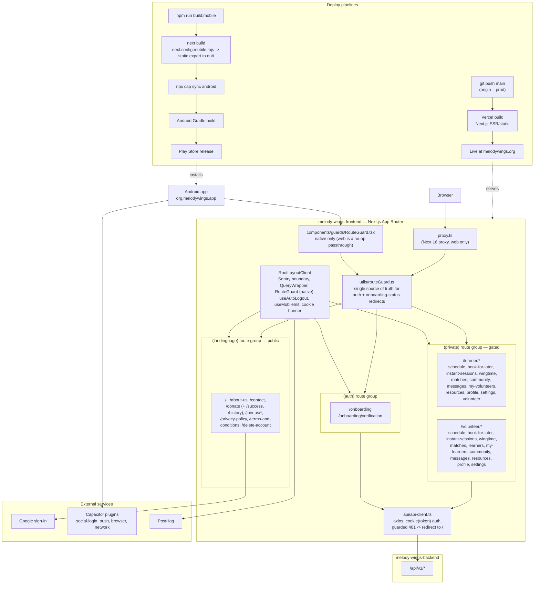
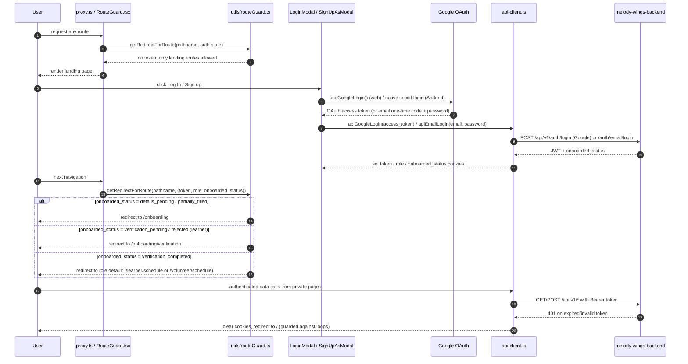

# melody-wings-frontend

Next.js (App Router) application for **Melody Wings** learners and volunteers. This is the end-user app for the platform — landing page, onboarding, session scheduling, community, chat, resources, and donations — and it also ships as a native Android app (`org.melodywings.app`) via Capacitor. It talks exclusively to [melody-wings-backend](../melody-wings-backend).

## Tech stack

| Layer | Technology |
|---|---|
| Framework | Next.js 16 (App Router), React 19, TypeScript |
| Data fetching / cache | `@tanstack/react-query` v5 |
| State | `zustand`, `nuqs` (URL state) |
| UI | `antd`, `@mui/material` + `@mui/x-date-pickers`, `framer-motion`, `@fullcalendar/*` |
| Forms | `react-hook-form` + `zod` |
| Auth | Google sign-in (`@react-oauth/google` on web, `@capgo/capacitor-social-login` on native) **and** email one-time code + password (`auth/email-otp/*`, `auth/email/signup`, `auth/email/login`) |
| Native shell | Capacitor (push/local notifications, network, browser, app lifecycle, status bar, keyboard, splash screen) |
| Analytics / errors | Google Analytics (consent-gated), PostHog (web only), Sentry (`@sentry/capacitor`) |
| Deploy | Vercel (web), static export + Gradle (Android) |

## Architecture



**Routing/auth gating**: there is no dedicated `/login` page — sign-in is a modal (`LoginModal`/`SignUpAsModal`) triggered from the landing page. All redirect logic (unauthenticated → landing, incomplete onboarding → `/onboarding`, rejected/pending learners → `/onboarding/verification`, completed users away from landing/cross-role pages → their role's default route) lives in one framework-agnostic module, `src/utils/routeGuard.ts`, consumed by both `src/proxy.ts` (web) and `RouteGuard.tsx` (native, since a static-exported Capacitor build has no Next proxy).

**Cookies are only a UX hint, not a security boundary.** `token`, `role`, `onboarded_status` and the ids are plain, JavaScript-writable cookies (the JWT signature is never verified in the browser), so the proxy / `routeGuard` only decide where to *send* people. The private shell (`MainLayout`) therefore asks the server (`GET onboarding/status/{role}/{id}`, owner or admin only) who the member really is before it renders anything, and corrects the cookie if it disagrees. The real authorization boundary is the backend: every privileged endpoint must check the caller's token and onboarding state itself.

**Sessions**: the JWT expires after 24 hours (no refresh token; a 401 clears the cookies and returns to `/?session=expired`). `useAutoLogout` additionally signs the member out after 30 minutes without activity, including time the app was closed.

## End-to-end flow

The full sign-in → onboarding → routing decision path, covering both the web (proxy-driven) and native (client-side `RouteGuard`) cases:



## Directory structure

```
src/app/
  layout.tsx, RootLayoutClient.tsx     # root shell: Sentry boundary, query client, native route guard, auto-logout
  page.tsx                             # "/" landing page
  (landingpage)/                        # public marketing routes
  (auth)/onboarding/                    # onboarding form + verification polling
  (private)/
    learner/                            # schedule, book-for-later, instant-sessions, wingtime, matches, community, messages, ...
    volunteer/                          # schedule, book-for-later, instant-sessions, wingtime, matches, learners, community, ...
src/proxy.ts                            # Next 16 proxy (formerly middleware.ts): web-only redirects via routeGuard

src/api/                # axios client + per-domain API functions (auth, chat, sessions, ...)
src/components/         # organized by domain: schedule, community, messages, learners/volunteers,
                        # profile, resources, onboarding, guards, common (Button/Input/Toast/...)
src/utils/              # routeGuard.ts (shared auth gating), auth.ts (cookies), timeFunctions.ts
                        # (timezone/slot conversion for availability scheduling), platform.ts
src/services/           # native-auth.ts (native Google sign-in), push-notifications.ts, policies.ts, sentry.ts, ...
src/providers/          # QueryWrapper (the one real QueryClient), theme, etc.

android/                # native Android project (Gradle), appId org.melodywings.app
capacitor.config.ts     # webDir "out", CapacitorHttp enabled, native plugin config
next.config.mobile.mjs  # static-export config swapped in only for mobile builds
```

## Auth

Two ways in, both from the landing-page modals:

- **Google**: web uses `useGoogleLogin` from `@react-oauth/google` (`GoogleOAuthProvider` is mounted only inside the landing-page header, not the root layout); native uses `nativeGoogleSignIn()` via the Capacitor social-login plugin. Both resolve to `apiGoogleLogin(access_token)` (`POST auth/login`) or `apiGoogleSignUp` (`POST auth/signup`).
- **Email + password**: a one-time code proves the email (`auth/email-otp/request` + `verify`), then `auth/email/signup` / `auth/email/login` / `auth/email/reset-password` (see `src/api/auth`).

The returned `onboarded_status` drives where `routeGuard.ts` sends the user next. Push notification permission is asked after sign-in (`enablePushForSignedInUser`), not at app start.

## Running locally

```bash
npm install
npm run dev       # http://localhost:3000
```

Set `NEXT_PUBLIC_API_URL` (defaults to `http://localhost:8002`) to point at a running [melody-wings-backend](../melody-wings-backend), plus `NEXT_PUBLIC_GOOGLE_WEB_CLIENT_ID` for Google sign-in. Other build-time `NEXT_PUBLIC_*` variables: `GOOGLE_IOS_CLIENT_ID`, `GOOGLE_IOS_URL_SCHEME`, `GOOGLE_ANALYTICS_ID`, `POSTHOG_API_KEY` / `POSTHOG_HOST`, `SITE_URL` (public web origin for donation return URLs, default `https://melodywings.org`), `PAGINATION` (member-list page size, default 9), `SUPPORT_EMAIL`, `CURRENT_VERSION`, `ENABLE_WINGTIME` (must match the backend flag), `ENABLE_DEV_LOGIN` (local only). `NEXT_PUBLIC_API_URL` also feeds the CSP `connect-src`; if it is unset the CSP omits the API origin.

Checks: `npm run typecheck`, `npm run lint`, `npm run test:unit`, `npx next build`.

### Mobile (Android) build

```bash
npm run build:mobile   # swaps in next.config.mobile.mjs, static-exports to out/, restores web config
npx cap sync android
npx cap open android    # or: npm run mobile:run / mobile:live for live reload
```

Native builds hit the production Cloud Run API hardcoded in `src/definitions.ts` (`api.melodywings.org` has no DNS record) rather than the web env var. A static export cannot send headers, so the Android WebView has no Content-Security-Policy (see the note in `next.config.mobile.mjs`).

## Schedule dashboard

`/learner/schedule` and `/volunteer/schedule` are the signed-in landing page
(`getDefaultRouteForRole`). Components live in `src/components/schedule/Dashboard/`:
Availability (recurring + date-specific slots, volunteer "Slots I'm Offering / I've Taken"),
My Schedule (Posted / Accepted / Direct tabs, Upcoming / Past), and the calendar with a
legend and Month / Week / Day views. Session categories come from
`scheduleCategories.ts`; status labels, the session date/time format and the Join rule
from `src/utils/sessionDisplay.ts` — use those instead of screen-local maps. Business
rules, API and privacy notes: `melody-wings-backend/docs/schedule-dashboard.md`.

## Known gaps

- The session JWT lives in a JavaScript-readable cookie (and in `localStorage` on native); moving it to an HttpOnly cookie needs a backend change. The CSP still allows `'unsafe-inline'` / `'unsafe-eval'` scripts (no nonce pipeline), and the mobile build has no CSP.
- No token refresh: the 24 h JWT simply expires.
- Several modals (community, some schedule dialogs) are still statically imported rather than lazy-loaded, and the UI stack is wide (antd + MUI + react-select + react-datepicker).
- Some Capacitor plugins in `package.json` have no imports (`@capacitor/camera`, `filesystem`, `haptics`, `preferences`); removing them needs a `cap sync` and an Android build check.
- `todo.txt` / `planning.txt` are old feature notes, not a current plan; `openapi.json` is a stale snapshot of the API.
- The mobile build rewrites files in place (`scripts/use-mobile-config.js` / `restore-web-config.js`); an interrupted build must be restored with `restore-web-config.js`.
- CI (`.github/workflows/ci.yml`) runs unit tests and `next build`; lint is non-blocking and `tsc --noEmit` is not yet a gate.
